# Run `demo-1-weak`

- builder: `recorded:demo-1`; learner: `llm-learner:cursor-agent:gpt-5.3-codex`; certification profile: `full`
- isolation audit (canaries): clean

## Timeline

### Round 1: ok
- builder attempt 1: CERTIFIED (0.0 s)
- device `stop_catapult` (v1); twins A and B studied separately
  - learner A: pretest 0%, exam 38%, experiments 62/80, prediction error first third 3.55 -> last third 0.87 tolerances; theory hit rates in_distribution: 25%, extrapolation: 12%, modified stop_post.posx=-0.064: 25%, modified slug.posz=0.734: 0%
    - belief: damping.bearing unit error 0.29, friction.concrete unit error 0.06 (covered), friction.steel unit error 0.38, friction.wood unit error 0.34 (covered), frictionloss.bearing unit error 0.32 (covered), gain.motor_large unit error 0.16 (covered), rolling.concrete unit error 0.18 (covered), rolling.steel unit error 0.61, ball_mass unit error 0.44, slug_mass unit error 0.52
  - learner B: pretest 33%, exam 75%, experiments 30/80, prediction error first third 2.78 -> last third 0.56 tolerances; theory hit rates in_distribution: 50%, extrapolation: n/a, modified stop_post.posx=-0.064: 38%, modified slug.posz=0.734: 25%
    - belief: damping.bearing unit error 0.32, friction.concrete unit error 0.04 (covered), friction.steel unit error 0.34, friction.wood unit error 0.39 (covered), frictionloss.bearing unit error 0.32 (covered), gain.motor_large unit error 0.27 (covered), rolling.concrete unit error 0.18 (covered), rolling.steel unit error 0.54 (covered), ball_mass unit error 0.11 (covered), slug_mass unit error 0.08 (covered)
- swap test (hit rates): {'A_on_A': 0.25, 'B_on_B': 0.5, 'A_on_B': 0.0, 'B_on_A': 0.0}
- controls: {'modification_effect_over_tol': {'stop_post.posx': 3.198663514581333, 'slug.posz': 2.46244834474315}, 'blackbox_exam_success': 1.0}

### Round 2: ok
- builder attempt 1: CERTIFIED (0.0 s)
- device `spring_stop_catapult` (v2); twins A and B studied separately
  - learner A: pretest 0%, exam 25%, experiments 62/62, prediction error first third 1.33 -> last third 0.54 tolerances; theory hit rates in_distribution: 25%, extrapolation: 0%, modified stop_post.posx=-0.064: 12%, modified striker.posz=0.726: 12%
    - belief: damping.bearing unit error 0.32, damping.rail unit error 0.12 (covered), friction.concrete unit error 0.02 (covered), friction.steel unit error 0.34, friction.wood unit error 0.37 (covered), frictionloss.bearing unit error 0.35 (covered), frictionloss.rail unit error 0.21 (covered), gain.motor_large unit error 0.20 (covered), rolling.concrete unit error 0.18 (covered), rolling.steel unit error 0.61, stiffness.torsion_soft unit error 0.04 (covered), ball_mass unit error 0.22 (covered), slug_mass unit error 0.15 (covered)
  - learner B: pretest 0%, exam 88%, experiments 62/62, prediction error first third 1.49 -> last third 0.57 tolerances; theory hit rates in_distribution: 12%, extrapolation: 25%, modified stop_post.posx=-0.064: 25%, modified striker.posz=0.726: 25%
    - belief: damping.bearing unit error 0.29, damping.rail unit error 0.03 (covered), friction.concrete unit error 0.06 (covered), friction.steel unit error 0.38, friction.wood unit error 0.34 (covered), frictionloss.bearing unit error 0.32 (covered), frictionloss.rail unit error 0.19 (covered), gain.motor_large unit error 0.38, stiffness.torsion_soft unit error 0.04 (covered), rolling.concrete unit error 0.18 (covered), rolling.steel unit error 0.61, ball_mass unit error 0.28, slug_mass unit error 0.40
- swap test (hit rates): {'A_on_A': 0.25, 'B_on_B': 0.125, 'A_on_B': 0.0, 'B_on_A': 0.0}
- controls: {'modification_effect_over_tol': {'stop_post.posx': 1.8010099386518996, 'striker.posz': 0.6302546945812186}, 'blackbox_exam_success': 0.75}

### Round 3: ok
- builder attempt 1: CERTIFIED (0.0 s)
- device `wide_mass_catapult` (v3); twins A and B studied separately
  - learner A: pretest 0%, exam 25%, experiments 62/62, prediction error first third 3.99 -> last third 3.6 tolerances; theory hit rates in_distribution: 12%, extrapolation: n/a, modified stop_post.posx=-0.072: 0%, modified striker.posz=0.7308: 12%
    - belief: damping.bearing unit error 0.25, damping.rail unit error 0.12 (covered), friction.concrete unit error 0.02 (covered), friction.steel unit error 0.31, friction.wood unit error 0.34 (covered), frictionloss.bearing unit error 0.42 (covered), frictionloss.rail unit error 0.16 (covered), gain.motor_large unit error 0.24 (covered), rolling.concrete unit error 0.18 (covered), rolling.steel unit error 0.61, stiffness.torsion_soft unit error 0.07 (covered), ball_mass unit error 0.19 (covered), slug_mass unit error 0.01 (covered)
  - learner B: pretest 0%, exam 62%, experiments 62/62, prediction error first third 2.23 -> last third 1.72 tolerances; theory hit rates in_distribution: 12%, extrapolation: 12%, modified stop_post.posx=-0.072: 12%, modified striker.posz=0.7308: 12%
    - belief: damping.bearing unit error 0.32, damping.rail unit error 0.03 (covered), friction.concrete unit error 0.06 (covered), friction.steel unit error 0.38, friction.wood unit error 0.32 (covered), frictionloss.bearing unit error 0.37 (covered), frictionloss.rail unit error 0.19 (covered), gain.motor_large unit error 0.24 (covered), rolling.concrete unit error 0.15 (covered), rolling.steel unit error 0.58, stiffness.torsion_soft unit error 0.00 (covered), ball_mass unit error 0.28 (covered), slug_mass unit error 0.51
- swap test (hit rates): {'A_on_A': 0.125, 'B_on_B': 0.125, 'A_on_B': 0.25, 'B_on_A': 0.0}
- controls: {'modification_effect_over_tol': {'stop_post.posx': 0.0, 'striker.posz': 1.7185414117823021}, 'blackbox_exam_success': 0.625}


## Learner sessions (main lineage)

- v1_main_s1: final phase done, 158 lab calls (0 rejected), 303 s
- v2_main_s2: final phase done, 162 lab calls (0 rejected), 326 s
- v3_main_s3: final phase done, 164 lab calls (0 rejected), 294 s

## Figures

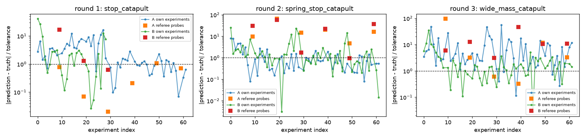
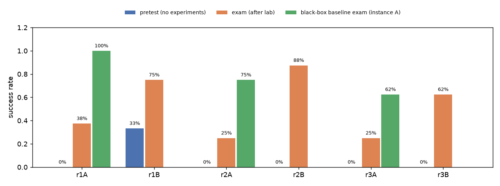

## Replays (instance A, re-simulated without actuation noise)

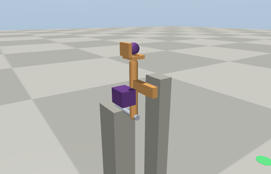
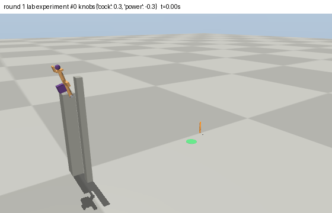
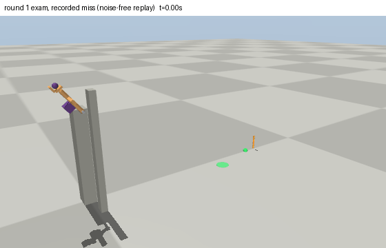
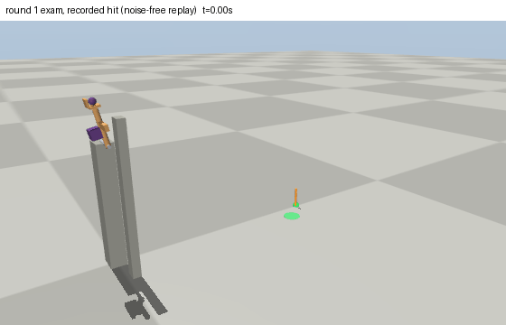
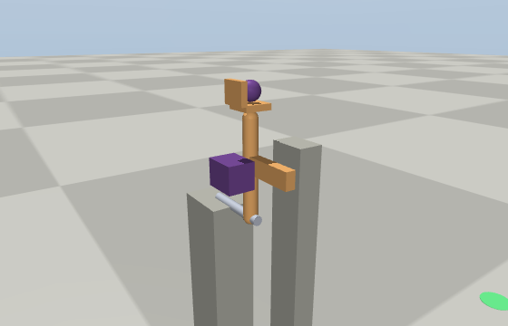
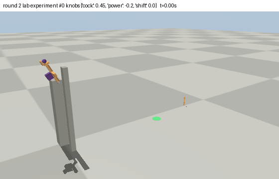
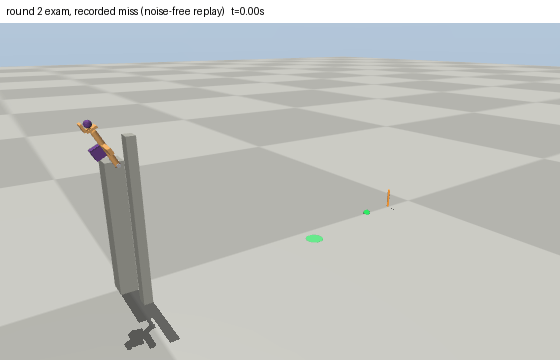
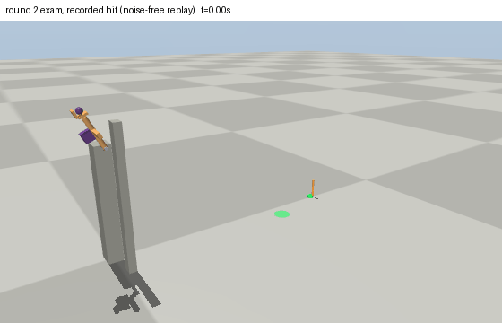

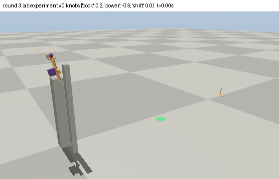
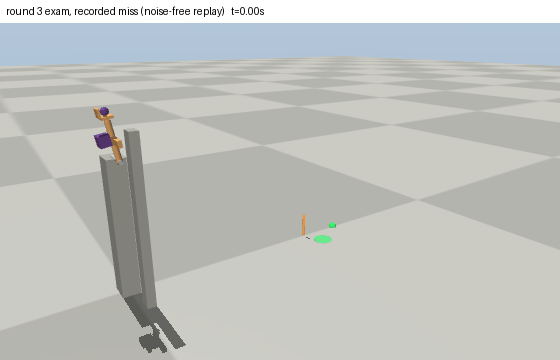


## World values (revealed after the run)

```json
{
 "damping.bearing": 0.01337,
 "damping.bushing": 0.02896,
 "damping.rail": 0.4491,
 "friction.aluminium": 0.24396,
 "friction.concrete": 0.61149,
 "friction.rubber": 0.98882,
 "friction.steel": 0.167,
 "friction.wood": 0.57757,
 "frictionloss.bearing": 0.00087,
 "frictionloss.bushing": 0.01572,
 "frictionloss.rail": 0.29568,
 "gain.linear_actuator": 7.24935,
 "gain.motor_large": 5.59889,
 "gain.motor_small": 1.12916,
 "rolling.aluminium": 0.00025,
 "rolling.concrete": 0.00056,
 "rolling.rubber": 0.00077,
 "rolling.steel": 0.0002,
 "rolling.wood": 0.00049,
 "stiffness.coil_soft": 94.03997,
 "stiffness.coil_stiff": 357.84994,
 "stiffness.torsion_soft": 1.58721,
 "stiffness.torsion_stiff": 7.38532
}
```

Raw material: `public/` (hash-chained channel log, task cards, round reports), `builder/` (design log and submitted designs), `learner/` (notebooks and theories).
