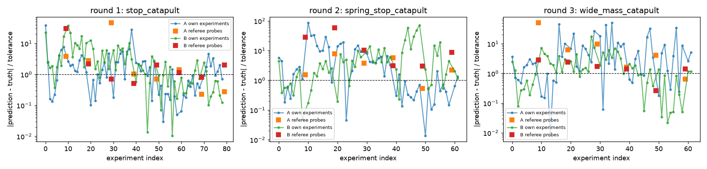
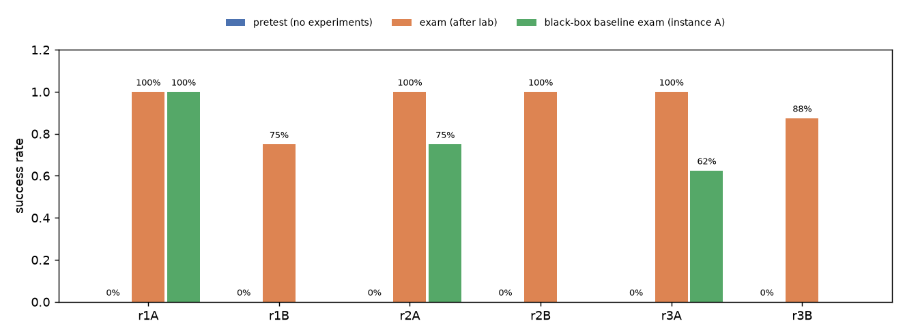
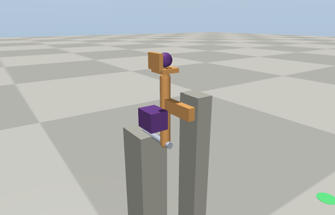
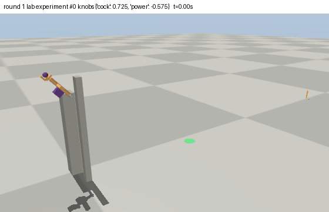
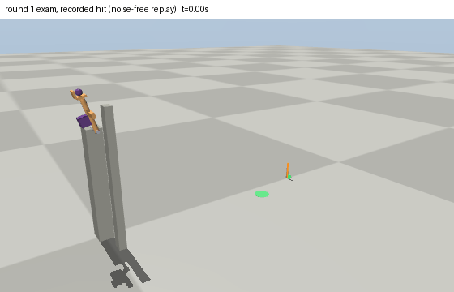
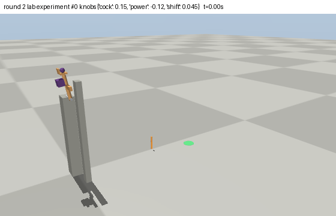
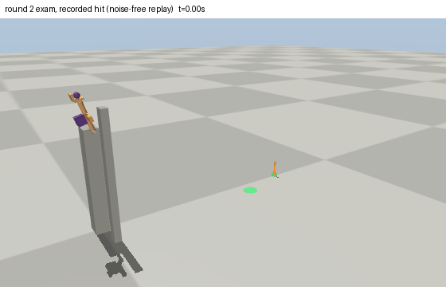
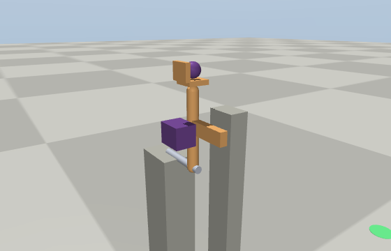
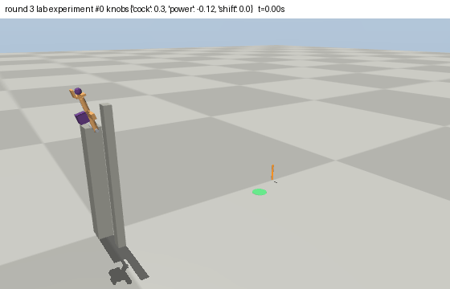
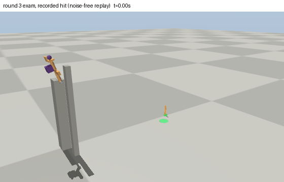

# Run `demo-1`

- builder: `llm-builder:cursor-agent:claude-opus-5-thinking-high`; learner: `llm-learner:cursor-agent:gpt-5.6-sol-high`; certification profile: `full`
- isolation audit (canaries): clean

## Timeline

### Round 1: ok
- builder attempt 1: CERTIFIED (62.6 s)
- device `stop_catapult` (v1); twins A and B studied separately
  - learner A: pretest 0%, exam 100%, experiments 80/80, prediction error first third 1.36 -> last third 0.57 tolerances; theory hit rates in_distribution: 88%, extrapolation: n/a, modified stop_post.posx=-0.064: 0%, modified slug.posz=0.734: 0%
    - belief: damping.bearing unit error 0.22 (covered), friction.concrete unit error 0.08 (covered), friction.steel unit error 0.44 (covered), friction.wood unit error 0.32 (covered), frictionloss.bearing unit error 0.44 (covered), gain.motor_large unit error 0.36 (covered), rolling.concrete unit error 0.21 (covered), rolling.steel unit error 0.71, ball_mass unit error 0.46 (covered), slug_mass unit error 0.42 (covered)
  - learner B: pretest 0%, exam 75%, experiments 80/80, prediction error first third 4.96 -> last third 0.53 tolerances; theory hit rates in_distribution: 62%, extrapolation: n/a, modified stop_post.posx=-0.064: 25%, modified slug.posz=0.734: 38%
    - belief: damping.bearing unit error 0.22 (covered), friction.concrete unit error 0.08 (covered), friction.steel unit error 0.44 (covered), friction.wood unit error 0.32 (covered), frictionloss.bearing unit error 0.45 (covered), gain.motor_large unit error 0.31 (covered), rolling.concrete unit error 0.21 (covered), rolling.steel unit error 0.71, ball_mass unit error 0.16 (covered), slug_mass unit error 0.13 (covered)
- swap test (hit rates): {'A_on_A': 0.875, 'B_on_B': 0.625, 'A_on_B': 0.0, 'B_on_A': 0.0}
- controls: {'modification_effect_over_tol': {'stop_post.posx': 3.198663514581333, 'slug.posz': 2.46244834474315}, 'blackbox_exam_success': 1.0}

### Round 2: ok
- builder attempt 1: CERTIFIED (76.9 s)
- device `spring_stop_catapult` (v2); twins A and B studied separately
  - learner A: pretest 0%, exam 100%, experiments 62/62, prediction error first third 5.11 -> last third 0.42 tolerances; theory hit rates in_distribution: 75%, extrapolation: n/a, modified stop_post.posx=-0.064: 0%, modified striker.posz=0.726: 62%
    - belief: damping.bearing unit error 0.25 (covered), damping.rail unit error 0.00 (covered), friction.concrete unit error 0.08 (covered), friction.steel unit error 0.44, friction.wood unit error 0.32 (covered), frictionloss.bearing unit error 0.44 (covered), frictionloss.rail unit error 0.14 (covered), gain.motor_large unit error 0.27, rolling.concrete unit error 0.18 (covered), rolling.steel unit error 0.68, stiffness.torsion_soft unit error 0.45, ball_mass unit error 0.59, slug_mass unit error 0.44
  - learner B: pretest 0%, exam 100%, experiments 62/62, prediction error first third 1.35 -> last third 7.66 tolerances; theory hit rates in_distribution: 50%, extrapolation: n/a, modified stop_post.posx=-0.064: 0%, modified striker.posz=0.726: 50%
    - belief: damping.bearing unit error 0.22 (covered), damping.rail unit error 0.00 (covered), friction.concrete unit error 0.08 (covered), friction.steel unit error 0.44 (covered), friction.wood unit error 0.32 (covered), frictionloss.bearing unit error 0.44 (covered), frictionloss.rail unit error 0.13 (covered), gain.motor_large unit error 0.36 (covered), rolling.concrete unit error 0.21 (covered), rolling.steel unit error 0.71, stiffness.torsion_soft unit error 0.05 (covered), ball_mass unit error 0.32 (covered), slug_mass unit error 0.15 (covered)
- swap test (hit rates): {'A_on_A': 0.75, 'B_on_B': 0.5, 'A_on_B': 0.0, 'B_on_A': 0.0}
- controls: {'modification_effect_over_tol': {'stop_post.posx': 1.8010099386518996, 'striker.posz': 0.6302546945812186}, 'blackbox_exam_success': 0.75}

### Round 3: ok
- builder attempt 1: CERTIFIED (88.0 s)
- device `wide_mass_catapult` (v3); twins A and B studied separately
  - learner A: pretest 0%, exam 100%, experiments 62/62, prediction error first third 1.3 -> last third 3.67 tolerances; theory hit rates in_distribution: 75%, extrapolation: n/a, modified stop_post.posx=-0.072: 0%, modified striker.posz=0.7308: 62%
    - belief: damping.bearing unit error 0.25 (covered), damping.rail unit error 0.00 (covered), friction.concrete unit error 0.08 (covered), friction.steel unit error 0.44, friction.wood unit error 0.32 (covered), frictionloss.bearing unit error 0.40 (covered), frictionloss.rail unit error 0.14 (covered), gain.motor_large unit error 0.24, rolling.concrete unit error 0.18 (covered), rolling.steel unit error 0.68, stiffness.torsion_soft unit error 0.44, ball_mass unit error 0.22, slug_mass unit error 0.25
  - learner B: pretest 0%, exam 88%, experiments 62/62, prediction error first third 1.19 -> last third 0.66 tolerances; theory hit rates in_distribution: 50%, extrapolation: n/a, modified stop_post.posx=-0.072: 0%, modified striker.posz=0.7308: 12%
    - belief: damping.bearing unit error 0.25 (covered), damping.rail unit error 0.00 (covered), friction.concrete unit error 0.08 (covered), friction.steel unit error 0.44, friction.wood unit error 0.32 (covered), frictionloss.bearing unit error 0.44 (covered), frictionloss.rail unit error 0.14 (covered), gain.motor_large unit error 0.27, rolling.concrete unit error 0.18 (covered), rolling.steel unit error 0.68, stiffness.torsion_soft unit error 0.45, ball_mass unit error 0.50, slug_mass unit error 0.46
- swap test (hit rates): {'A_on_A': 0.75, 'B_on_B': 0.5, 'A_on_B': 0.0, 'B_on_A': 0.0}
- controls: {'modification_effect_over_tol': {'stop_post.posx': 0.0, 'striker.posz': 1.7185414117823021}, 'blackbox_exam_success': 0.625}

## Builder sessions

- call 1 (round 1): submitted=True, 40 tool calls, 1103 s
  <details><summary>builder's final message</summary>

I'll start by reading the inbox and the docs.Design is planned: a motor-driven catapult arm that slams a hard stop and flings a sealed ball. Writing it now.Construction is valid. Running the certification check now.Now I'll sweep the reachable landing range across extreme worlds.The motor drives the wrong way — positive torque pushes the arm away from the stop. Flipping the command sign.C3 learnability is the only failure. I'll make the device heavier (shorter throws, solutions nearer the middle of the knob range) and re-sweep.Adding a ball-velocity sensor and a bigger budget to help the gray-box learner identify the launch.Certified. The fixed-action margin is thin (29.5% vs 30% limit), so I'll tighten the tolerance slightly and re-verify.Certified with healthy margins. Submitting now.Submitted. Now writing the design log.Round 1 is submitted: `stop_catapult` passed local certification on every check, and the submission is in `outbox/submission.json` with a copy at `designs/v1.py`.

**The device.** A wooden arm hinges on top of a concrete column. At its tip is a shallow cup with one retaining lip, holding a sealed steel ball; a sealed slug is clamped part-way out along the arm. A striker plate offset in +y is the only thing that can reach the concrete stop post (also offset in +y, so it never blocks the flight path). The learner cocks the arm away from the post, the motor drives it back, the striker slams the post, the arm halts dead, and the ball flies off as a projectile. The outcome is the ball's landing x, with a goal band of −1.52 to −1.02 m at 0.055 m tolerance and 80 experiments.

**Why it resists guessing.** Launch speed is motor work minus the centre-of-mass climb, divided by the arm's inertia, and the inertia carries both hidden masses while the ball's mass also divides into the kinetic-energy budget. Solving with prior-centre parameters hits 16% of goals, and the best single fixed action reaches 25%. The two publicly modifiable dimensions, the stop post's x position (the stop angle, hence launch elevation) and the slug's height along the arm (its inertia), both move the landing point substantially.

**Two things cost real time.** `b.hidden()` returns a log string rather than a handle, so `hidden_mass` wants the hidden's name. More importantly, a positive motor command drives the hinge away from the post, so the `power` knob is declared negative; I only caught that by writing a direct sweep script, since the construction checks happily passed. That same sweep over weak/heavy and strong/light corners of the prior is what located the landing window reachable in *every* world, roughly −1.06 to −1.57 m, which the goal space now sits inside.

The remaining tension is between C2 and C3: at 0.05 m tolerance the gray-box learner hit only 3 of 6, while 0.055 m with a 0.50 m span gives 6 of 6 and keeps fixed-action coverage at 25%. The log records the escalation ladder for v2, starting with putting the slug on a latched slide so its position becomes a third knob and the two hidden masses stop acting as a single multiplier.
</details>
- call 2 (round 2): submitted=True, 42 tool calls, 855 s
  <details><summary>builder's final message</summary>

I'll start by reading the inbox and my design log.Now writing v2 with a torsion spring (confounded energy source) and a slide-mounted sealed slug set by a third knob.Found something important: outcome responds to knobs and the hidden masses, but not to motor gain. Let me verify the actuator quickly, then run certification.Running the real certification now — it's the authoritative signal and I need it before submitting.Certified. `relevant_parameters` shows motor gain does matter (my local harness had a bug). Saving this as a fallback, then pushing one step harder.The spring now genuinely confounds with motor gain, but the gray-box learner fell to 4/6 at budget 50. Restoring a bit of budget.Certified, but the oracle margin (21/24) is thinner than I'd like for an unseen world. Narrowing the goal span slightly to buy C1 headroom.The hole is mid-range, not at the edges — so that was the wrong fix. Reverting to the wide goal space with a gentler spring offset and slightly wider knobs.Good margins now. One risk remains: fixed-action coverage at 0.27 against a 0.3 cap. Extending the goal space on the far end (which every world reaches easily) buys margin there.All margins are comfortable now. Submitting.Submitted. Now updating the design log.Round 2 is submitted: `spring_stop_catapult`, certified locally with comfortable margins on every check.

**Why v2 is harder.** The round-1 report said the learner scored 88% (above the 30–80% band) and that a model-free curve-fitter also hit 100%, so v1 was brute-forceable. I kept the v1 tower, arm, cup, striker and stop post so world knowledge transfers, and added two new mechanisms:

A torsion spring on the hinge now feeds the throw alongside the motor. Spring work scales with the square of the cocking angle while motor work scales with the angle times the command, so the learner has to separate two confounded energy sources by varying one knob at a time. The certification confirms both `stiffness.torsion_soft` and `gain.motor_large` move the outcome.

The sealed slug moved off its fixed mount onto a rail along the arm, clamped by a latch that never releases, and its clamp position became a third knob. That stops the two hidden masses from collapsing into a single multiplier: the clamp position moves the arm's inertia while leaving the ball's share of the kinetic energy untouched. I also removed the ball velocity sensor and cut the budget from 80 to 62, and the second modifiable dimension is now the striker height, which sets the angle at which the arm is arrested and hence the launch elevation.

**Two things worth recording.** My hand-written sweep script seemed to show the outcome was completely insensitive to motor gain and spring stiffness, which would have meant the device was nearly trivial. That was a bug in my harness — the certifier's `relevant_parameters` lists both — so I stopped trusting the sweep and iterated on `forge check` instead. Separately, when C1 existence failed, the unreachable goals turned out to sit in the *middle* of the goal span, so shrinking the span made it worse; extending the far end instead fixed C1 and simultaneously pulled the single-fixed-action coverage back from 0.27 to 0.219, well clear of its 0.3 cap.

Final local numbers: oracle 24/24, knob-perturbation robustness 144/144, prior-centre necessity 0.109, fixed-action coverage 0.219, and the gray-box learner at 6/6 after 62 experiments, with pre-experiment outcome uncertainty of 8.1× tolerance. The `design_log.md` entry records the rejected intermediate variants and the next escalation ideas, with a mid-throw latch release for stick-slip on the rail as the leading candidate.
</details>
- call 3 (round 3): submitted=True, 40 tool calls, 995 s
  <details><summary>builder's final message</summary>

I'll start by reading the inbox and getting oriented.Time is tight (32 min). Let me check the IR signatures quickly, then write v3.Docs confirm `duration` accepts a knob name. Writing v3: the slug latch now releases mid-throw (stick-slip on the rail), with release timing as a fourth knob — a genuine piecewise boundary.Mechanic is stable (C1 1.00, C1b 1.00) but budget 46 is too tight for the gray-box learner, and hidden-dependence is a bit weak. Raising the budget and widening the sealed masses.The sliding slug defeats the gray-box reference learner (0/6 at both budgets), so I'm pivoting the escalation: keep the clamped slug and make the drive path-dependent with a motor burst followed by a spring-driven coast.The common factor in both failures is the *duration* knob — the reference learner can't handle a variable phase length. Reverting to a fixed drive phase with three knobs while keeping the wider sealed masses, to secure a pass first.Certified, but with big margins and only a thin escalation. Saving this as a fallback, then spending the remaining time tightening tolerance and budget to actually make it harder.Tolerance 0.042 is too tight for the reference learner. Trying an intermediate point.Four of six — just under the bar. One notch back, then I submit.Reference-learner score is dominated by seed noise (1/6 at a *looser* tolerance than the 4/6 run), so I'll maximise its headroom with a large budget while keeping the harder tolerance and mass range.Seed noise confirmed — same structure gave 6/6 and 1/6. The widened slug mass is what lowered the reference learner's average, so I'm reverting it and taking the escalation from tolerance alone.Certified with strong margins (nominal necessity 0.031, reference learner 6/6). Fixing the escalation text to match what I actually shipped, then re-running once on a fresh seed to confirm it isn't a lucky draw.Tolerance 0.048 sits on the edge. The oracle and learner both miss goals at the far end of the span, so I'll trim that end rather than loosen tolerance.Certified with margin (oracle 24/24, reference learner 5/6). Fixing one now-inaccurate phrase in the escalation text, then submitting.Submitted. Now updating the design log while there's time.Submitted v3 to `outbox/submission.json`, locally certified with margin on every check.

**What shipped:** v2's sprung stop-block catapult with the mechanism unchanged (so world knowledge transfers), tightened tolerance 0.055 → 0.048, widened publicly modifiable dimensions (`stop_post.posx`, `striker.posz`), and a goal span trimmed to [-1.52, -1.02]. Final numbers: oracle 24/24, neighbours 135/144, nominal necessity 0.094, fixed-action coverage 0.232, posterior predictive 0.001 × tolerance, gray-box learner 5/6.

**The interesting part is what I couldn't ship.** I built two genuinely new mechanics this round and both died on C3 learnability, not on physics:

- A clamp that *releases mid-throw*, so the sealed slug runs along the rail under centrifugal load and changes the arm's inertia during the swing, with a piecewise boundary where the dwell outlasts the swing. Physics was spotless (C1 24/24, C1b 192/192, C2 necessity 0.172), but the gray-box reference learner scored 1/6 at budget 46 and 0/6 at budget 72 — raising the budget made it *worse*.
- A burst-and-coast drive where the motor switches off partway and the torsion spring finishes the throw. Reference learner 1/6.

The common factor is a knob that sets a **phase duration**. `PhaseIR.duration` accepts a knob reference, but the reference learner evidently cannot fit a model whose phase lengths move, so that whole family of escalations is closed to me until the referee says otherwise.

I also found that the C3 learnability statistic is only 6 trials and is dominated by seed noise: the identical structure scored 6/6 and 1/6 on two draws, and a *looser* tolerance scored worse than a tighter one. So tuning tolerance or budget against it is mostly chasing noise. The one change that raised it fo
</details>

## Learner sessions (main lineage)

- v1_main_s1: final phase done, 120 lab calls (1 rejected), 271 s
- v2_main_s2: final phase done, 153 lab calls (1 rejected), 367 s
- v3_main_s3: final phase done, 152 lab calls (0 rejected), 285 s

## Figures




## Replays (instance A, re-simulated without actuation noise)











## World values (revealed after the run)

```json
{
 "damping.bearing": 0.01337,
 "damping.bushing": 0.02896,
 "damping.rail": 0.4491,
 "friction.aluminium": 0.24396,
 "friction.concrete": 0.61149,
 "friction.rubber": 0.98882,
 "friction.steel": 0.167,
 "friction.wood": 0.57757,
 "frictionloss.bearing": 0.00087,
 "frictionloss.bushing": 0.01572,
 "frictionloss.rail": 0.29568,
 "gain.linear_actuator": 7.24935,
 "gain.motor_large": 5.59889,
 "gain.motor_small": 1.12916,
 "rolling.aluminium": 0.00025,
 "rolling.concrete": 0.00056,
 "rolling.rubber": 0.00077,
 "rolling.steel": 0.0002,
 "rolling.wood": 0.00049,
 "stiffness.coil_soft": 94.03997,
 "stiffness.coil_stiff": 357.84994,
 "stiffness.torsion_soft": 1.58721,
 "stiffness.torsion_stiff": 7.38532
}
```

Raw material: `public/` (hash-chained channel log, task cards, round reports), `builder/` (design log and submitted designs), `learner/` (notebooks and theories).
