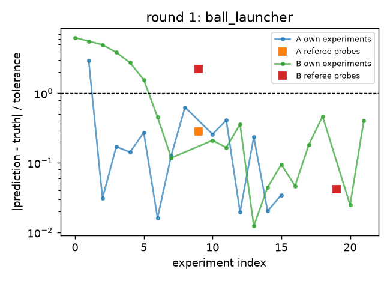
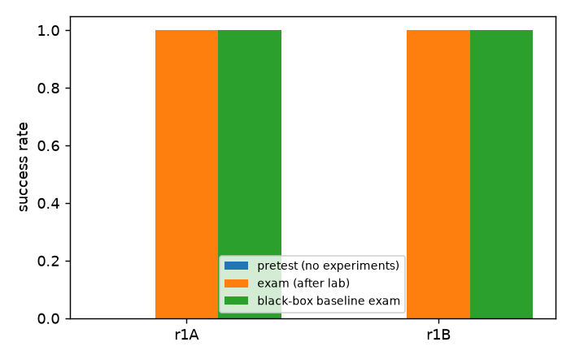

# Run `llm-learner-smoke`

- builder: `reference`; learner: `llm-learner:cursor-agent:gpt-5.3-codex`; certification profile: `fast`
- isolation audit (canaries): clean

## Timeline

### Round 1: ok
- builder attempt 1: CERTIFIED (8.5 s)
- device `ball_launcher` (v1); twins A and B studied separately
  - learner A: pretest 0%, exam 100%, experiments 16/40, prediction error first third 0.16 -> last third 0.03 tolerances; theory hit rates in_distribution: 100%, extrapolation: n/a, modified ball.posx=0.089: 0%
    - belief: damping.rail unit error 0.11 (covered), friction.concrete unit error 0.02 (covered), friction.steel unit error 0.38, friction.wood unit error 0.39 (covered), frictionloss.rail unit error 0.30 (covered), rolling.concrete unit error 0.15 (covered), rolling.steel unit error 0.58, stiffness.coil_stiff unit error 0.56
  - learner B: pretest 0%, exam 100%, experiments 22/40, prediction error first third 4.43 -> last third 0.14 tolerances; theory hit rates in_distribution: 100%, extrapolation: n/a, modified ball.posx=0.089: 0%
    - belief: damping.rail unit error 0.15 (covered), friction.concrete unit error 0.14 (covered), friction.steel unit error 0.21 (covered), friction.wood unit error 0.39 (covered), frictionloss.rail unit error 0.30, rolling.concrete unit error 0.24 (covered), rolling.steel unit error 0.68, stiffness.coil_stiff unit error 0.48
- swap test (hit rates): {'A_on_A': 1.0, 'B_on_B': 1.0, 'A_on_B': 1.0, 'B_on_A': 1.0, 'note': 'not informative: the device has no device-specific hidden quantity, so both instances share identical physics'}
- controls: {'modification_effect_over_tol': {'ball.posx': 6.026055675150532}, 'blackbox_exam_success': 1.0}


## Learner sessions (main lineage)

- v1_main_s1: final phase done, 47 lab calls (0 rejected), 278 s

## Figures




## World values (revealed after the run)

```json
{
 "damping.bearing": 0.01337,
 "damping.bushing": 0.02896,
 "damping.rail": 0.4491,
 "friction.aluminium": 0.24396,
 "friction.concrete": 0.61149,
 "friction.rubber": 0.98882,
 "friction.steel": 0.167,
 "friction.wood": 0.57757,
 "frictionloss.bearing": 0.00087,
 "frictionloss.bushing": 0.01572,
 "frictionloss.rail": 0.29568,
 "gain.linear_actuator": 7.24935,
 "gain.motor_large": 5.59889,
 "gain.motor_small": 1.12916,
 "rolling.aluminium": 0.00025,
 "rolling.concrete": 0.00056,
 "rolling.rubber": 0.00077,
 "rolling.steel": 0.0002,
 "rolling.wood": 0.00049,
 "stiffness.coil_soft": 94.03997,
 "stiffness.coil_stiff": 357.84994,
 "stiffness.torsion_soft": 1.58721,
 "stiffness.torsion_stiff": 7.38532
}
```

Raw material: `public/` (hash-chained channel log, task cards, round reports), `builder/` (design log and submitted designs), `learner/` (notebooks and theories).
