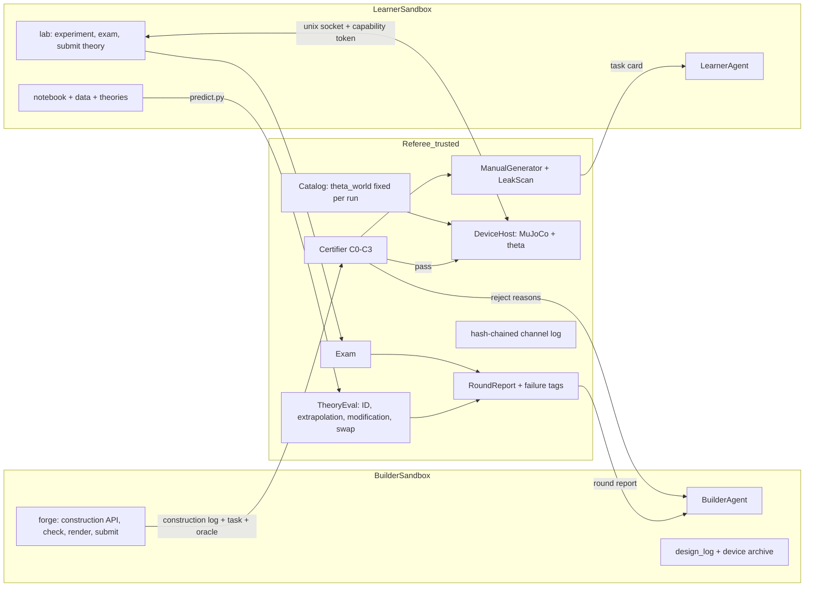

# 终极方案：一个 Agent 造机器，另一个 Agent 学会使用（MuJoCo）

本文整合了 `codex/`、`gemini/` 与 claude 之前的方案，后文简称“三份方案”。第 0 节交代取舍依据，第 1 节讲宏观设计，第 2 节讲细节设计，第 3 节列里程碑与风险。

> **实施状态（2026-11-07）**：M1 到 M4 已完成：正式演示 `demo-1` 跑完 3 轮，较弱模型和清空笔记两组对照也已完成。过程记录见 `docs/process.md`。实现过程中，方案有以下偏差，均登记在 `docs/decisions.md`：
> - D-003：构造层采用 IR -> MJCF XML。
> - D-004：任务采用声明式定义，存在性证书使用通用 oracle。
> - D-011：步长改为 0.001 s；步长收敛只在命中解上检验，阈值为 1 倍容差；C2 在先验上评估。
> - D-012：C2 的样本量从 3 个先验实例增加到 24 个；孪生实例采用对偶采样；没有装置专属隐藏量时，互换测试标记为“不具信息量”。
> - D-013：沙箱采用手写 SBPL，不使用 srt。
> - D-014：会话设截止时间；C2 结果标注 BORDERLINE。
> - D-015：未知量标注作用范围（world 或 device）。
> - D-016：封闭共享临时目录。
> - D-017：C3 参考学习者加大拟合预算，建造者自检与裁判一致，FULL 做两次独立拟合。“断电滑行”类设计仍对种子敏感，未解决。
> - D-018：新增 C3 改装检验，改装尺寸必须让结果移动至少 1.5 倍容差；无区分力的改装考题不计入失败。
> - D-019：基础设施故障自动重试，仍失败的会话标为无效、不计分；补充了电脑睡眠和连接卡死的识别。
> - D-020：C3 参考学习者补上灰区加测。试过的另外三种改法均未采用；参考学习者的能力上限是裁判最主要的未解决问题。
> - D-021：预测可以为 null（“预计没有有效结果”）；探针预测校验失败不再吞掉探针。两者都由学习者的工单发现。
> - 第二次闭环 `demo-2` 已完成 4 轮有效运行（第 5 轮因电脑睡眠丢失）。
> - P1 中已提前实现的部分：MuJoCo 回放、`rerun-learner`（强弱模型对照、失忆消融）。
> - D-023：交付物新增观察窗网页（`observatory/` 与 `web/`），可回放已录制的运行，也可令牌保护地直播进行中的运行。
> - 计划中尚未实现：反事实世界（θ-tracking）、新手迁移测试、匿名化任务卡消融、policy-as-code 闭环动作接口。

---

## 0. 三份方案的评审与取舍

### 0.1 codex 方案（只有设计文档，没有实现）

强项，全部采纳：
- 每次实验必须“先预测再观测”，学习者的预测误差曲线就是学习过程的直接证据。
- 孪生加互换测试：两个隐藏参数不同的实例，各自学到的模型互换后应当双双失败。
- 每轮多个隐藏参数实例，统计单元是实例而不是单次尝试，并给出 bootstrap 置信区间。
- 考试目标在考试时才揭晓，每个目标只有一次机会。
- 用 Fisher 信息检查可辨识性。
- 裁判侧的防护：MJCF 名称混淆、报错净化、RPC 能力令牌、哈希链信道日志。
- 自动推导失败标签，例如 `model_bias_<param>`、`budget_exhausted`、`extrapolation_fail`。
- 消融：仅先验、打乱观测、随机实验、黑盒搜索。

弱项，替换掉：
- 依赖 OpenAI 兼容 API key，本机没有配置。
- 隔离依赖 Python 审计钩子。Python 官方文档明确说明审计钩子不是沙箱，可以被绕过。
- 建造者只写 JSON，缺少构造过程中的物理校验。

### 0.2 gemini 方案（有完整实现和图表，根目录下的 `src/`、`tests/`、`outputs/` 是它的副本）

核实代码后发现的问题，下面这些写成红线，本方案必须避免：
- 两个 Agent 都不是 LLM，而是手写脚本。
  - 建造者的四台机器是写死的。“初稿无解、随后修复”是故意设置的，见 `builder_agent.py:140`，注释原文为 `Over-stiff initial proposal -> ZPD verifier will relax!`。
  - 学习者代码里写死了针对具体机器的解题分支（绕行、闸门、弹道制动）和物理常数。例如 `learner_agent.py:556-557` 直接给出劲度和阻尼，`:600-603` 写死平衡点 `(0.0, -0.08)`，`:614-617` 是撞击力度和制动时刻的经验公式。
  - 结论：它展示的“发现闸门”“学会定时制动”，实际上是作者把解法写进了学习者。这正是题目禁止的“解题方法泄漏”，只不过泄漏通道是写代码的人，而不是进程之间。
- 报告中的模型 R² 被人为设了下限（`learner_agent.py:629`：`max(r2, 0.92 if obs.solved else 0.58)`），所以 R² 约 0.92 这一结论不可信。
- 它的进程隔离检查的是“子进程有没有导入 mujoco”，而真正的泄漏点不在这里。

可借鉴，采纳：
- 多阶段动作程序：每段包含前馈控制，加上可选的 PD 反馈增益。这样不需要实时调用 LLM 也能做简单的闭环控制。
- “机制跃迁”式的升级：新版本要让旧理论失效，比如加入障碍、联锁闸门、动量传递，而不只是改数值。
- 零输入被动检查：什么都不做时，系统不应自己就满足目标。
- 图表和 GIF 的展示形式。

### 0.3 claude 之前的方案

强项，保留：
- 零件目录的隐藏物性在整个 run 中固定，并且建造者不知道真值。
- 构造即校验的 API（BuildArena 式）。
- 理论即代码（`predict.py`），并在外推和改装情形下检验。
- OS 级沙箱加 canary 审计。
- 裁判元评测：带标签的作弊测试集，加上置信区间灰区。
- 冻结学习者 prompt。
- 声明升级维度。

弱项，调整：
- 原方案过于庞杂。
- “每 10 次实验一次 quiz”改为：每次实验都必须先预测，第 10、20、30 次实验由裁判指定动作，相当于穿插在实验中的无偏探针。
- “平行世界 θ-tracking”改为孪生互换测试。因为理论是代码，裁判可以离线完成互换，不增加 LLM 成本。
- 去掉 AUCCESS：考试改为每个目标只有一次机会，直接报成功率和偏差分布。

---

## 1. 宏观设计

### 1.1 课题本质

这是一个“AI 工程师 × AI 科学家”的最小闭环，也是吴泰霖实验室 BuildArena（LLM 在物理仿真里造机器）的自然延伸。BuildArena 论文自己指出了两条局限：缺少基于仿真评估的外层闭环，组件库不足。本题正好补上这两点。

系统必须回答三个问题：
1. **隔离**：只允许“任务卡、操作和观测接口、结构化反馈”在两个 Agent 之间流动，并且能证明没有其他通道。
2. **可解**：挑战必须“不做实验解不出，做了实验一定解得出”。这件事要靠证书保证，不能依赖建造者自觉。
3. **学会**：学习者的能力要能被证明来自交互，而不是来自先验或运气，更不能来自系统设计者写进去的解法（gemini 的教训）。

### 1.2 六条设计原则

1. **裁判是唯一中介，也是唯一计分者。** 所有指标都由裁判用真值独立计算，学习者和建造者自报的数字只作为被检验的对象。
2. **能力边界由系统强制，不靠 prompt 承诺。** 手段包括 OS 沙箱、工具白名单、RPC 能力令牌、阶段锁。
3. **答案在结构上不可泄露。**
   - 零件物性的真值连建造者也不知道。
   - 学习者能看到的只有自动生成的说明书和接口。
   - 系统设计者在看到任何装置之前就冻结学习者的 prompt，并记录哈希。
   - 学习者必须是通用 Agent，代码里不能有针对具体装置的分支。
4. **可解要有证书，困难要有必要性证明。** 两者都在有噪声的条件下、按置信区间判定。
5. **学到的必须是可检验、可迁移的理论。** 用外推、改装、孪生互换做反事实检验。
6. **失败必须真实。** demo 中的失败全部来自真实运行，任何“故意失败”都禁止。

### 1.3 架构



### 1.4 一轮的生命周期

1. 建造者（新会话）读取上一轮报告和自己的设计档案，用构造 API 搭出新版装置，在本地 `forge check` 通过后提交。
2. 裁判做权威认证。不通过就退回具体原因，最多重试 5 次。通过后自动生成任务卡。
3. 裁判从建造者声明的先验中采样两个孪生实例 A 和 B，它们的 \(\theta_{device}\) 不同，\(\theta_{world}\) 相同。
4. 学习者在 A、B 上各开一个新会话，两个会话都从上一轮主线笔记的同一个快照出发。每个会话依次完成：前测、实验室、提交理论、考试、反馈 ticket。下一轮继承的主线笔记只来自 A，B 是用于孪生互换的分支。
5. 裁判计算指标：考试、预测曲线、理论的四类检验、失败标签、旧理论失效度。生成 round report 交给建造者。
6. 进入下一轮，默认共 4 轮。

### 1.5 三个问题的答案总览

- **隔离**：分三层。
  - 能力层：工具白名单、能力令牌、阶段锁。
  - 系统层：每个角色一份 OS 沙箱；关闭 CLI 自带的记忆功能；禁止读取对方的会话记录。
  - 信息层：建造者不知道真值；说明书自动生成；名称混淆；报错净化；泄漏扫描。
  - 验证手段：canary 审计、沙箱自检、哈希链信道日志。
- **可解**：C0 到 C3 证书阶梯。
  - 物理合理：构造期加动力学检查。
  - 存在性：oracle 拿到真值、在有噪声条件下的成功率不低于 0.8。
  - 鲁棒：PHYRE 式稳定解。
  - 必要性：名义参数、固定动作、随机策略都必须失败。
  - 可辨识：Fisher 信息检查，加上灰盒参考学习者在预算内成功。
  - 裁判本身用一套带标签的作弊集做元评测。
- **学会**：分五层证据，由弱到强。
  1. 前测到考试的提升；
  2. 先预测再观测的误差曲线；
  3. 理论在外推和改装情形下仍然成立；
  4. 孪生互换后双双失败；
  5. 消融对照（仅先验、打乱观测、随机实验、失忆、弱学习者）。

---

## 2. 细节设计

### 2.1 物理世界与零件目录

- **零件**：基座板、杆、板、轮、球、密封盒、铰链、滑轨、弹簧、阻尼器、电机、闩锁、滑轮或 tendon、目标区。可见属性包括几何尺寸和材料名。
- **材料**：钢、铝、木、橡胶，密度取真实值。
- **介质**：空气或水，水中使用 MuJoCo 的流体力模型。
- **\(\theta_{world}\)**：每个 run 由裁判用私有种子采样一次，之后不变。建造者只看得到每项物性的先验范围。包括：
  - 材料对之间的滑动摩擦和滚动摩擦；
  - 恢复系数（由 `solref` 实现）；
  - 各型号铰链的阻尼；
  - 各型号弹簧的劲度；
  - 各型号电机的力矩常数；
  - 介质的密度和粘度、风。
- **\(\theta_{device}\)**：建造者在装置里声明的隐藏量，比如密封盒的质量和内部偏心。裁判按实例采样。先验范围的 max/min 比不超过 10。

### 2.2 建造者

- **构造 API**（Python，包装 `mujoco.MjSpec`；工具分组参照 BuildArena 的 Build / Refine / Assemble / Control / Query）：
  - 主要操作：`start(base)`、`attach(part, to=anchor, joint=...)`、`tendon(...)`、`actuate(joint, motor_model)`、`latch(...)`、`sense(name, kind, target, noise)`、`goal_zone(...)`、`query()`、`render()`。
  - 每一步都会增量编译，并检查四件事：
    - 非相邻零件之间的穿透是否超过零件尺度的 1%；
    - 连接图是否连通（每个可动件都要经关节链连到基座）；
    - 支撑：在重力下静置是否稳定；
    - 密度是否与材料表一致。
  - 违规时返回实测值、阈值和修改建议，例如“摆臂与底座重叠 3 毫米，建议把铰链上移 5 毫米”。
  - 禁止的操作：悬空焊接到世界坐标、修改碰撞过滤、使用 `xfrc_applied`、写原始 MJCF。
- **任务定义**：
  - `goal_family`：参数化的目标空间，比如篮筐位置的范围。
  - `success(outcome, goal)`：只能使用公开可观测的结果量。
  - 不超过 600 字的目标描述。
  - `escalation`：声明本版在哪些维度升级。
  - `modifiable`：允许裁判在改装检验中公开修改的可见尺寸。
- **证人解**：`oracle(goal, theta) -> ActionProgram`。它的输出必须落在公开动作空间内，并且走与学习者完全相同的执行通路。
- **交付契约**：最终输出必须是符合 JSON schema 的说明，内容包括设计意图、升级维度、预期的学习者难点。
- **记忆**：`design_log.md`，加上历代装置档案（成功和失败的版本都保存，参照 OMNI-EPIC）。
- **目标**：把学习者的考试成功率保持在 0.3 到 0.8 之间，也就是 learnability 最高的区间；同时要求前测明显低于考试。优先做“机制跃迁”，并复用目录里已有的零件。

### 2.3 动作与观测接口

- **动作程序**（借鉴 gemini 并做了泛化）：最多 K 段。每段包含：
  - 时长；
  - 各执行器的归一化设定值，范围 \([-1, 1]\)；
  - 可选的、作用在已声明传感器上的 PD 增益；
  - 离散触发，例如闩锁在第几秒释放。
  - 裁判负责校验格式和取值范围。
- **观测**：只来自白名单里的 MuJoCo sensor，由裁判加噪声后返回。通道名来自说明书里的通用名，不暴露任何内部名称。可以选择只返回关键帧或降采样后的数据，作为部分可观测这一难度维度。

### 2.4 学习者协议（`lab` 强制执行）

每个实例对应一个会话，按以下顺序进行：

1. **任务卡**：说明书由裁判从构造记录自动生成，包括零件清单、拓扑、可见尺寸，隐藏量打码；再加上目标描述、动作和观测 schema、预算。
2. **前测**：3 个一次性目标，本实例零实验。考的是先验加跨轮记忆。
3. **实验室**：E 次实验，默认 40 次。每次都必须附带对关键结果的预测。第 10、20、30 次由裁判指定动作，作为无偏探针。实验时允许自由设定目标参数。
4. **提交理论**：`predict.py`，接口为 `predict(program, visible_params) -> outcome`；同时提交 belief report，即隐量的估计值和 90% 区间。
5. **考试**：8 个目标，逐个揭晓，每个只有一次机会。考试期间禁止做实验。
6. **field report**：结构化 ticket，类别为 interface_bug、ambiguous_spec、suspected_unsolvable、too_easy，每条附不超过 280 字的说明。
- **记忆**：`notebook.md`、`data/`、`theories/`（每个理论注明适用域和参数个数）。下一轮从主线快照继续。
- **工具**：`lab` 是只依赖标准库的客户端，学习者可以在自己的分析脚本里批量调用。Python 环境里有 numpy、scipy、mujoco 和 matplotlib，学习者可以自建近似的仿真模型。

### 2.5 裁判与证书（每次提交都用私有种子重新认证）

- **C0 物理合理**：构造期检查（见 2.2），加上动力学检查：
  - 不出现 NaN；
  - 无输入时能量增长不超过 1%；
  - dt 减半后关键结果变化不超过 5%；
  - 零输入时不会自行满足目标。
- **C1 存在性**：oracle(\(\theta\)) 在有观测噪声和执行噪声时的成功率不低于 0.8，在若干组（目标，\(\theta\)）样本上统计。
- **C1b 鲁棒**（PHYRE 稳定解）：对动作施加 ±1% 量程的邻域扰动后，成功率不低于 0.6。
- **C2 必要性**：以下三种策略的成功率都要不超过 0.3：先验均值下的 oracle、全局最佳固定动作、随机策略。
- **C3 可辨识**：两项检查都要通过。
  - 一组探测实验得到的 Fisher 信息矩阵，在决策相关参数上的最小特征值超过阈值；
  - 灰盒参考学习者只通过公开接口、在预算内用仿真反演拟合 \(\hat\theta\)，oracle(\(\hat\theta\)) 的成功率不低于 0.7。
- **C3b 泄漏和过易检验**（P1）：只看任务卡、零实验的新手 LLM，成功率要不超过 0.3。
- **判定方式**：用 Wilson 置信区间，分为“通过 / 灰区 / 不通过”三档；落在灰区就追加试验。
- **元评测**：`fixtures/` 里放带标签的合格装置和作弊装置。作弊装置包括：悬空、互穿、凭空施力、无解、过易、刀锋、泄题、不可辨识。统计误拦率和误放率；阈值在一部分样例上调、在另一部分上验证；再做阈值敏感性分析。运行中统计每条规则的拒绝次数，异常偏高的人工抽查。
- **代码与 LLM 的分工**：所有硬门禁都用代码。LLM 只用于语义上的软评审，输出结构化建议，不做裁决。

### 2.6 证明学习：证据与对照

裁判计算的指标：
- 前测与考试的成功率，以及偏差分布；
- 先预测再观测的误差曲线，自选实验和裁判探针分开统计；
- `predict.py` 的误差，分四类：
  - 分布内；
  - 外推：超出学习者探索过的动作范围；
  - 改装：裁判公开修改一个 `modifiable` 尺寸；
  - 孪生互换：把 A 的理论拿到 B 上用，以及反过来；
- belief 估计：只在可辨识子空间（Fisher 信息矩阵的主方向）上打分，并统计 90% 区间的覆盖率；
- 实验次数、token 数、工具调用次数；
- 旧理论失效度：上一轮的理论在新装置上的误差，用来判断这次升级是不是真的“换了物理”。

对照组：
- **LLM（P1，按预算选做）**：
  - 仅先验新手，同时充当泄漏探测器；
  - 失忆学习者：从空笔记开始；
  - 较弱模型的学习者：检验评测有没有区分度，也观察建造者会不会因材出题；
  - 任务卡匿名化：参照 PhysGym 的 L4 级别。
- **脚本（P0，多种子）**：
  - 通用黑盒学习者：在公开接口上做贝叶斯优化，不针对任何装置；
  - 打乱观测：喂入另一实例的观测；
  - 随机实验：替换掉学习者自选的实验；
  - 灰盒参考学习者：作为上界。
- **统计口径**：统计单元是实例。LLM 运行按个案报告并注明 n；脚本对照报告 bootstrap 置信区间。

### 2.7 反馈信道（共五条，全部写入哈希链日志）

1. 建造者到裁判：构造记录、任务定义、oracle、JSON 交付说明。
2. 裁判到学习者：任务卡（自动说明书，加上经过数值泄漏扫描的目标描述）。
3. 学习者到裁判：动作与预测、`predict.py`、belief、ticket。
4. 裁判到建造者：round report，内容包括汇总指标、证书结果与参考学习者成功率、失败标签、旧理论失效度、ticket。不含学习者的 transcript、笔记和代码。
5. 建造者到学习者（间接）：下一版任务卡，加上自动生成的结构变更 changelog。

### 2.8 隔离实现

- **沙箱**：每个角色一份策略，共四个角色：建造者、学习者、DeviceHost（运行建造者代码，不联网，只能写自己的 tmp 目录）、理论执行器（运行 `predict.py`，不联网，只读自己的理论文件）。
  - 优先用 Anthropic `srt` 的 JSON 策略；不兼容时，参照 codex 开源的默认拒绝式 `seatbelt_base_policy.sbpl` 手写。
  - 学习者禁止读取的位置：建造者区、裁判区、`claude/` 源码与 `fixtures/`、`~/.codex`、`~/.cursor/projects/*/agent-transcripts`、`~/.cursor/plans`、其他 run 目录，以及工作区根目录下的 `codex/`、`gemini/`、`src/`。
  - 建造者对学习者区和学习者的会话记录做对称的禁止。
- **RPC**：Unix socket 加能力令牌，方法白名单按角色划分。
- **信息防护**：MJCF 名称混淆、报错净化、观测只含声明过的字段。
- **CLI 记忆**：每个会话都是新会话。私有工作区放在项目树外（`~/mlab-runs/<run_id>/`）。如果使用 codex 后端，加 `--ephemeral --disable memories`（实测本机 codex 的 memories 默认开启）。
- **设计者泄漏防护**：
  - 学习者 prompt 只描述工具和规则，不含物理提示；在任何装置产生之前冻结，并把哈希写入 `prompts/hashes.json`；
  - 脚本学习者必须是装置无关的，只在建造者生成的装置上测试，永远不针对具体装置调参；
  - 代码审查规则：`agents/` 目录中不得出现任何装置名或物理常数。
- **审计**：私有文件里埋入 canary 字符串，扫描学习者的全部产物；运行前先跑 `sandbox-selftest`。

### 2.9 Agent 运行时

- **后端接口**：`run_session(role, workspace, prompt, model, timeout) -> transcript, final_json`。
  - 默认用 cursor-agent CLI：`-p --output-format stream-json --model <m> --workspace <ws> --trust --force --sandbox disabled`，外层套 OS 沙箱。用 cursor-agent 的原因是本机已登录，不需要 API key。
  - 可选 codex CLI：`exec --json --output-schema --ephemeral --disable memories`。
  - 可选（P2）：OpenAI 兼容 API 加自写的工具调用循环（codex 方案的做法），需要 API key。
  - scripted：用于离线复现和 CI，必须明确标注为参照，不作为 demo 的主体。
- **模型**：按角色配置。
  - 建造者用强模型，例如 Claude Opus 5 或 GPT-5.6 Sol High，因为构造和写 oracle 是最难的工程部分。
  - 学习者主实验用强模型；对照组用较弱模型，例如 Gemini 3.7 Flash。
  - 开发调试阶段用快且便宜的模型。
- **控制**：每个会话有超时和工具调用上限；在一个会话内可以 resume，跨会话不行；记录 token 数。

### 2.10 代码结构（`claude/`）

```
claude/
  pyproject.toml  README.md  DESIGN.md  终极方案.md
  mlab/
    catalog/     parts.py materials.py world.py
    construct/   api.py checks.py describe.py render.py
    referee/     protocol.py host.py rpc.py certify.py reference.py baselines.py
                 exam.py theory_eval.py manual.py leak.py metrics.py report.py channel.py
    agents/      backend.py cursor_cli.py codex_cli.py scripted_builder.py scripted_learners.py
                 prompts/{builder.md, learner.md, hashes.json}
    sandbox/     policies.py selftest.py audit.py
    cli/         forge.py lab.py(stdlib only) main.py
    analysis/    plots.py replay.py demo_report.py
  fixtures/devices/   good/ bad/   (labeled set for referee meta-evaluation)
  tests/              test_construct_rejects_cheats.py test_certify_suite.py test_leak.py
                      test_sandbox.py test_protocol_locks.py test_theory_eval.py test_scripted_loop.py
  demo/               recorded/<run_id>/ (index.md, videos, figures, channel log)
```

- 运行命令：
  - `uv run mlab run --rounds 4 --builder-model <m> --learner-model <m>`：真实 LLM 运行；
  - `uv run mlab run --scripted`：离线运行；
  - `uv run mlab selftest`、`uv run mlab audit <run_id>`、`uv run mlab report <run_id>`。
- 运行时只记录“动作加随机种子”，视频与图在运行后从日志重放生成（借鉴 BuildArena 2.0）。

---

## 3. 里程碑、交付物与风险

### 3.1 里程碑

- **M1 物理核心（P0）**：零件目录与 \(\theta_{world}\)；构造 API 加校验；两台手写的合格夹具装置；八类作弊夹具；证书 C0 到 C3；元评测测试。
- **M2 裁判与协议（P0）**：DeviceHost、RPC 与能力令牌；完整的阶段协议；先预测再观测；裁判探针；考试；理论四类评测；指标与报告；脚本学习者和脚本建造者；离线闭环跑通。
- **M3 隔离与运行时（P0）**：沙箱策略与自检；cursor-agent 后端；冻结 prompt；LLM 建造者和 LLM 学习者跑通一轮。
- **M4 正式运行（P0）**：4 轮、每轮 2 个孪生实例的真实 LLM 运行；导出 demo；撰写 `DESIGN.md` 和 `README.md`，引用文献先核验。
- **M5 增强（P1）**：仅先验新手、失忆、弱学习者、匿名化消融；回放视频。
- **P2**：policy-as-code 闭环控制接口、OpenAI 兼容后端、黑盒难度带、水下介质。

### 3.2 交付物

1. 可运行的代码，以及运行说明（README）。
2. 演示（`demo/recorded/`）：一次真实运行的时间线，包含建造过程（含被拒绝的步骤）、证书退回、实验与预测、前测失败、理论演化、考试、互换测试、建造者升级。另附离线脚本运行，用于复现。
3. 设计记录（`DESIGN.md`，两页以内）：隔离、可解、学会三个问题，每条结论都指向对应的证据文件。

### 3.3 风险

- **LLM 建造者经常造不出合格装置**：报错写得具体、附带修改建议；提供玩具示例；每轮最多重试 5 次。构造失败率作为一项指标如实报告。整轮失败也如实记录，不用脚本替代。
- **运行耗时与成本**：4 轮 × 2 个实例，共 8 个学习者会话和 4 个以上建造者会话，预计 2 到 3 小时。会话数和实验预算可以配置。
- **`srt` 与 CLI 网络不兼容**：只用它的文件系统和 socket 限制，网络放开；先跑自检。
- **灰盒参考学习者知道结构**：它只能证明“原则上可解”。它与 LLM 学习者之间的差距衡量的是结构发现的难度，这一点在设计记录里明确写出。
- **macOS 离屏渲染**：渲染失败时退回 matplotlib 轨迹图。

### 3.4 红线（来自评审的反模式）

- 学习者代码中出现装置名、装置专属的分支或物理常数。
- 编排好的失败，或者为了演示效果而故意设置无解初稿。
- 由学习者自报，或经过钳制、改写的指标。
- 看过装置后再修改学习者的 prompt 或工具。
- 只跑单种子、单实例就下结论。
